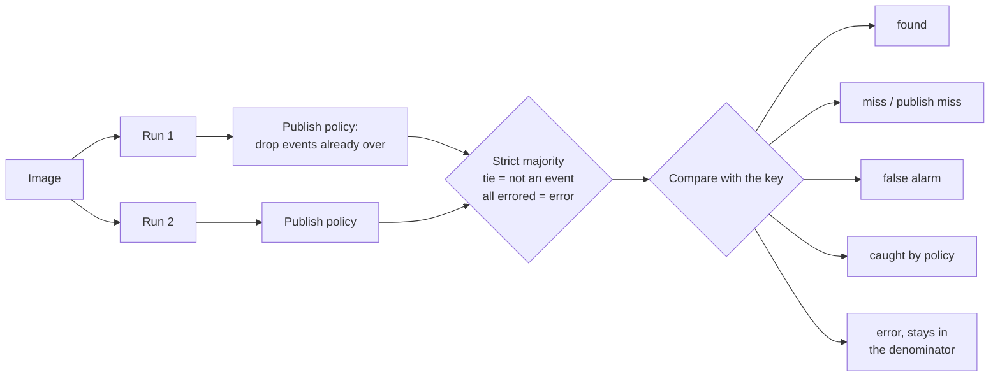

# extraction-evals

How I decide whether a prompt change to a production LLM pipeline actually
helped. The pipeline powers [Tardeo](https://tardeo.ai), a free agenda of
evening plans in Málaga, Sevilla, Fuengirola and Marbella: a vision model reads
what about 70 venues post, extracts the events, and code publishes them every day.

**The result, in short (October study).** A prompt change (`narrower`) cut false alarms from 8 to 5 on
400 images and shipped under an acceptance rule fixed in advance. Its rules had
been written from errors on those same images, so I ran it again on 331 images
seen after it shipped. There both prompts had 1 false alarm: the gain did not
replicate. On the same new images, my review of the 15 items where two models
disagreed changed the production model's count from 8 misses to 2. Full write-up:
[`REPORT.md`](REPORT.md), which also covers a November follow-up: a fresh
held-out set and an outside review that found five flaws in my own method.

## When a prompt change is proposed

A change to the extraction prompt or its schema, from me or from a coding agent
working on the service, is run against the current prompt on the same images and
scored here. It is accepted only if, on all items pooled, it has no more
publish-level misses than the current setup, and it has fewer false alarms (or
costs less with no more false alarms). The exact text is in
[`docs/hit-rule.md`](docs/hit-rule.md). I make that call; it is a check a person
applies, not an automatic gate. That includes edits that look unrelated: a
change to an unrelated field description in the extraction schema changed two
answers on the held-out set.

## How an image is scored (October study)



The flip rate (items whose runs disagree) is counted on the raw answers, before
the policy. It does not set the noise floor alone: also report the per-run range
of error counts across several runs. On a new held-out set the error count of one
model moved by 5 items across 5 runs of the same setup. What counts as each
outcome was written down before any number existed: [`docs/hit-rule.md`](docs/hit-rule.md).

The harness:

- counts **misses and false alarms apart**, because they cost different things;
- keeps **errors in the denominator**, so a model cannot score better by failing;
- scores at **two levels**, what the model read and what would be published, so a
  past event stopped by the policy gets its own count instead of disappearing;
- reports the **flip rate** and the **per-run range** of misses and false alarms,
  and a paired exact McNemar test between two models;
- is the **acceptance check** for a prompt change (see above).

## Run it

```bash
npm install
npm test                                   # scorer tests
npm run score -- examples/synthetic        # scores every answers-*.json there;
                                           # with 2+ files also prints ranges and paired p
```

`prompts/extract-v1.md` is a short stand-in written for this repo. It asks for
the same decision production makes (event or not, start, end, weekdays) but it
is not the production prompt, which also writes the post text and is not
published. The numbers in `REPORT.md` come from the production prompt, run
privately.

`examples/synthetic/answers-fixture.json` is written by hand to show every
outcome. It is not a model's output. To score a real model on the synthetic set
(20 images, well under a dollar):

```bash
ANTHROPIC_API_KEY=... npm run run-model -- examples/synthetic claude-sonnet-5-5 --runs 2
npm run score -- examples/synthetic
```

`examples/synthetic/answers-claude-sonnet-5-5.json` is a real run of that command
(16 October 2026, under a dollar): no misses and no false alarms on the 20 posters,
which are easy by design. They show the method, not the model.

`npm run posters` re-renders the 20 posters from `examples/synthetic/posters.json`.
Every venue, act and offer in them is invented.

## What the tests lock

The 30 tests in `src/__tests__/score.test.ts` pin the rules that change the
numbers: errors stay in the denominator; a tie votes "not an event"; the policy
runs on each answer before the vote; the flip rate is counted before the policy;
a real event dropped for a wrong past end is a publish miss, not a read miss; a
date-only end lasts the whole day; a time with no offset reads the same on every
machine; full weekday names match three-letter keys. The paired comparison is
locked too: exact McNemar values (4 against 9 gives about 0.27, 9 against 10
gives 1, 0 against 0 gives 1), symmetry, large counts, the per-run range, and
the discordant-pair counts for misses and false alarms.

Code: `src/score.ts` (the rules, no I/O), `src/cli.ts` (reads the files, prints
the table), `scripts/run-model.ts` (runs a Claude model with
`prompts/extract-v1.md`).

## Author

Nacho González-Garilleti. MIT licence.
