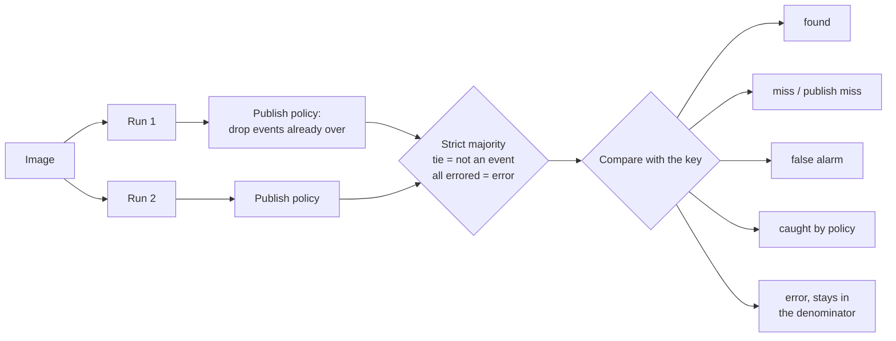

# extraction-evals

How I decide whether a prompt change to a production LLM pipeline actually
helped. The pipeline powers [Tardeo](https://tardeo.ai), a free agenda of
evening plans in Málaga, Sevilla, Fuengirola and Marbella: a vision model reads
what about 70 venues post, extracts the events, and code publishes them every day.

**The result, in short.** A prompt change (`ab`) cut false alarms from 8 to 5 on
400 images and shipped under an acceptance rule fixed in advance. Its rules had
been written from errors on those same images, so I ran it again on 331 images
seen after it shipped. There both prompts had 1 false alarm: the gain did not
replicate. On the same new images, my review of the 15 items where two models
disagreed changed the production model's count from 8 misses to 2. Full write-up:
[`REPORT.md`](REPORT.md).

## When a prompt change is proposed

A change to the extraction prompt or its schema, from me or from a coding agent
working on the service, is run against the current prompt on the same images,
twice each, and scored here. It ships only if it has no more misses and no more
false alarms than the current prompt, and fewer of the errors it was written to
fix. I make that call; it is a check a
person applies, not an automatic gate. Since a one-line edit to an unrelated
schema field moved two answers on the held-out set, that includes edits that
look unrelated.

## How an image is scored



The flip rate (items whose runs disagree) is counted on the raw answers, before
the policy, and sets the noise floor for any comparison. What counts as each
outcome was written down before any number existed: [`docs/hit-rule.md`](docs/hit-rule.md).

The harness:

- counts **misses and false alarms apart**, because they cost different things;
- keeps **errors in the denominator**, so a model cannot score better by failing;
- scores at **two levels**, what the model read and what would be published, so a
  past event stopped by the policy gets its own count instead of disappearing;
- reports the **flip rate**, the noise floor;
- is the **acceptance check** for a prompt change (see above).

## Run it

```bash
npm install
npm test                                   # scorer tests
npm run score -- examples/synthetic        # scores every answers-*.json there
```

`prompts/extract-v1.md` is a short stand-in written for this repo. It asks for
the same decision production makes (event or not, start, end, weekdays) but it
is not the production prompt, which also writes the post text and is not
published. The numbers in `REPORT.md` come from the production prompt, run
privately.

`examples/synthetic/answers-fixture.json` is written by hand to show every
outcome. It is not a model's output. To score a real model on the synthetic set
(20 images, well under a dollar):

```bash
ANTHROPIC_API_KEY=... npm run run-model -- examples/synthetic claude-sonnet-5-5 --runs 2
npm run score -- examples/synthetic
```

`examples/synthetic/answers-claude-sonnet-5-5.json` is a real run of that command
(16 October 2026, under a dollar): no misses and no false alarms on the 20 posters,
which are easy by design. They show the method, not the model.

`npm run posters` re-renders the 20 posters from `examples/synthetic/posters.json`.
Every venue, act and offer in them is invented.

## What the tests lock

The 23 tests in `src/__tests__/score.test.ts` pin the rules that change the
numbers: errors stay in the denominator; a tie votes "not an event"; the policy
runs on each answer before the vote; the flip rate is counted before the policy;
a real event dropped for a wrong past end is a publish miss, not a read miss; a
date-only end lasts the whole day; a time with no offset reads the same on every
machine.

Code: `src/score.ts` (the rules, no I/O), `src/cli.ts` (reads the files, prints
the table), `scripts/run-model.ts` (runs a Claude model with
`prompts/extract-v1.md`).

## Author

Nacho González-Garilleti. MIT licence.
