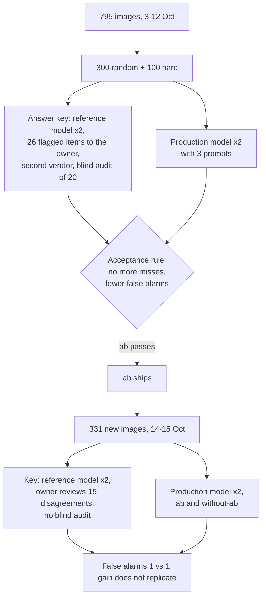

# Report: measuring a prompt change on a production extraction pipeline

**Status: final, 16 October 2026.** The owner answered every open item on 16
October: 6 disputes and a blind audit of 20 agreements in the main set, and 15
disputes in the held-out set. All counts below include those answers.

## Summary

- **Decision.** Prompt `ab` shipped: on 400 images it had 1 miss against the
  baseline's 2 and 5 false alarms against 8, which meets the acceptance rule set
  before scoring. Prompt `all` was rejected: fewer false alarms, but 5 misses.
- **Limit.** `ab`'s two rules were written from errors on those same 400 images,
  so that result is in-sample.
- **Held-out.** On 331 images seen after it shipped, both prompts had 1 false
  alarm. The false-alarm gain did not replicate; `ab` was one miss better.
- **Voting.** Every item was answered twice; a tie counts as "not an event".
- **Key caveat.** On the held-out set the owner reviewed only the 15 items where
  the reference and production models disagreed, and overturned the reference
  on 9. Without that review the production model would have scored 8 misses
  instead of 2.

## The system

A service reads images that bars and venues post publicly, decides whether each
one announces a plan someone could go to, extracts the date, and publishes the
plans to city channels and a web agenda. A vision model does the reading. Code
does everything after that, including the rule that drops events already over.

This report measures one change to the extraction prompt: what it fixed, what
it broke, and whether the gain held on images seen after it shipped.

## The data

The private runs used public venue posts, not in this repo.

- 400 images seen between 3 and 12 October 2026, from 70 venues in four cities.
- 300 drawn at random from the 795 usable images of that window: a sample of
  what the pipeline saw in those ten days and nothing wider.
  Then 100 "hard" items from the rest: quotas for the categories that cause
  trouble (reposts of another venue's event, opening hours, weekly plans, drink
  and dish photos, dates far ahead with no year, events already over, giveaways,
  job calls, cancellations), filled up with items where models disagreed.
- 91 of the 400 are events under the key. That is the denominator for misses. Images are scored independently, and a venue often posts
  the same plan more than once, so the number of distinct events is somewhat lower and
  was not counted.

The random and hard sets are reported together below. They are also scored
apart, and the hard set is never used to make claims about production rates.

## The answer key

A key built from the model under test grades that model against itself. So:

1. A reference model (Claude Opus 5.5, high effort) answered every item twice.
   It was chosen because it is not the model under test and it is the largest
   model from the same vendor; the steps below check it rather than trust it.
   The production publish rule was applied to its answers too.
2. Items where its two runs disagreed, where it disagreed with the production
   model, where the two picked different days, or where two cheap models both
   contradicted it, were flagged.
3. 26 items were flagged in total. The owner answered 20 of them on a review
   page, and the owner's answer always wins; 3 verdicts flipped. He answered the
   last 6 later, and 2 more flipped.
   Flagging leans on disagreement, so an item where both Claude models are wrong
   in the same way is the least likely to be flagged; that is what the blind
   audit below is for.
4. A second vendor (GPT-6 Astra, one run, $1.75) answered the 26 disputed items,
   12 posters of events already over, and 20 random items where the models agreed.
   - On the 20 agreements it agreed with the key on 19. The one disagreement was
     its own mistake: a clearly dated concert poster.
   - On the 12 past posters it agreed with the key on 11 that a poster of an
     event already over is not an event.
   - On the disputes it disagreed 8 times: 4 on items the owner had already
     answered, 2 clear mistakes of its own, and 2 borderline items (one about
     timing, one ambiguous) that the owner then settled.

Agreement between models is not truth, so the owner also labelled the 20
agreements blind, without seeing any model's answer. He agreed with the key on
19. The one he overturned is a story that points to a link for the details: not
enough on the image itself to publish. So about 1 key error in 20 where both
Claude models agree. The second vendor did not catch that one; its single
disagreement on the 20 was a different item and its own mistake.

## Results

The production model (Claude Sonnet 5.5, medium effort) with three prompts.

The prompt ends with a list of things that are not an event. The three prompts
differ only in lines added to that list:

- **Baseline**: the prompt as it ran in production before this work.
- **`ab`** adds two lines. (a) A photo of a dish, drink or menu, or a news
  piece about a shop, is not an event unless it states a deal or an event.
  (b) Footage of a night that is happening now or already happened (a crowd
  dancing, "anoche", a recap) is not an event, unless it announces a future
  date, says the plan repeats or continues, or sells tickets.
- **`all`** adds (a), an earlier and stricter wording of (b) without the
  "continues" and "tickets" exceptions, and (c) plans aimed only at children,
  families or seniors are not events.
Two runs per item. Read and publish levels are defined in `docs/hit-rule.md`.
All 400 items:

| Prompt | Misses | False alarms (published) | Caught by policy | Day right* | Items that flipped |
|---|---|---|---|---|---|
| Baseline | 2 | 8 | 9 | 83 of 87 | 3 |
| `ab`: food-photo rule + recap rule (shipped) | 1 | 5 | 9 | 86 of 89 | 2 |
| `all`: first recap wording + audience rule | 5 | 2 | 8 | 82 of 85 | 0 |

\* Out of the events found whose key has a day. The key leaves the day empty on
a few events with no single date (2 of those the baseline found, 1 each for the
others; 3 for both prompts on the held-out set), so this column is a few
short of events found.

By slice, misses / false alarms:

| Prompt | Random (300, 51 events) | Hard (100, 40 events) |
|---|---|---|
| Baseline | 1 / 3 | 1 / 5 |
| `ab` | 0 / 3 | 1 / 2 |
| `all` | 2 / 0 | 3 / 2 |

`ab` is no worse than the baseline on either slice. Its false-alarm gain is all
in the hard slice. On the random slice it has one miss fewer and the same false alarms.

Pooled counts can hide new errors, so item by item: `ab` fixes 2 misses and 6
false alarms the baseline makes, and introduces 1 miss and 3 false alarms of its
own.

No run errored. On this set misses are the same at the read and publish levels
for every prompt: the publish rule never threw away a real event because of a
wrong end date. On the held-out set it did, once (below).

## Read this first: the result is in-sample

The two rules in `ab` were written after reading the production model's errors
on these same 400 images. So the table shows that the rules fix the errors they
were written for, with fewer errors overall on this set. It does not show
how much they help on new images. That is what the held-out set below tests, and
on it the false-alarm gain does not replicate.

The acceptance rule also looks only at misses and false alarms. Dates are
reported but do not gate a change: `ab` gets 3 days wrong against the
baseline's 4, so it is no worse, but a prompt could pass the rule and still put
an event on the wrong night.

## What the numbers say

- **`ab` was shipped.** It meets the acceptance rule on the pooled counts: no
  more misses than the baseline (1 against 2) and fewer false alarms (5 against 8).
- **`all` was rejected**, although it has the fewest false alarms. It more than
  doubled the misses (5 against 2). One of its five is shared with the baseline. The four new ones:
  two children's shows (dropped by the audience rule), a "last weekend of the
  season" post (dropped by the first recap wording), and a borderline news post
  about a charity event, which `ab` also misses. The owner decided family plans
  stay, and the shipped recap wording says a continuing run is still an event.
- **The publish rule carries real weight.** At the read level the production
  model calls 8 or 9 items "an event" that the key says are not, each with an end
  before the moment it was seen. The rule that drops ended events removes all of
  them. For `ab`, all 9 were checked against the key's notes: match screenings
  and gigs from the night before, seen the next day. The reference model's own
  answers have 0 such cases, because it rejects them while reading. That gap is
  invisible with only one score. On this set it means the date check is doing
  work the prompt does not, so removing it would need its own test.

## Held-out check: the false-alarm gain does not replicate

331 images seen on 14 and 15 October, after `ab` shipped, from the same 70
venues. Same models and two runs each, but a lighter review: the owner saw only
the 15 items where the reference and production models disagreed, with no
blind audit. `without-ab` is the shipped prompt with the two `ab` lines
removed.

| Prompt | Misses (read) | Misses (publish) | False alarms | Day right* |
|---|---|---|---|---|
| `ab` (shipped) | 1 | 2 | 1 | 120 of 122 |
| `without-ab` | 3 | 3 | 1 | 119 of 121 |

127 of the 331 are events under the key. The misses, item by item:

- Both prompts miss a new bar's opening day.
- A cinema promotion is a gallery whose first image prints no dates. The shipped
  prompt reads it as an event but guesses the publication day as its end, so the
  publish rule drops it. `without-ab` rejects it outright. Both lose it.
- A third event only `without-ab` misses.

Both prompts publish the same false alarm: a concert story with no date or time
on it. So at the publish level the prompts differ on one found event, and the shipped
prompt introduces no error of its own. The in-sample false-alarm drop (8 to 5)
does not appear: both have 1. Neither prompt flipped between runs here.

The 15 items the reference and production models disagreed on went to the
owner. He overturned the reference model on 9 of them. Against the final key,
the reference model has 3 misses and 6 false alarms on this set, more than the
production model. Most of the 9 were stories with too little on the image to
plan around (a crowd photo, a link to tap, a poster with no day or price), which
the reference model called events. So on new data the key was only as good as
the owner's review of the disagreements. Without that step the report would have
said the production model misses 8 events; it misses 2.

On this held-out set `ab` added no miss or false alarm, and its one-item gain is too small
to call. Shipping them was defensible under the rule as written, and
the held-out run is what the rule should have required before shipping.

On 16 October production changed one field description in the extraction
schema (whether the post invites a public comment). It does not touch the date
or event rules, but production now differs from the prompt measured here by
that one line.

## What the numbers do not support

- **That `ab` is better by a precise amount, or at all on new images.** The
  margins are 1 miss and 3 false alarms in-sample, and 1 miss held-out. Run-to-run
  flips are close to that size: 3 items flipped between the baseline's two runs,
  one of them a real event it found once and missed once. The false-alarm drop is
  all in the hard slice. The decision is a rule on counts, fixed before the
  variants were scored, not a significance claim, and it is in-sample (above).
- **Production rates.** 400 images over ten days, from 70 venues in
  four cities. The random slice is a sample of that mix and nothing wider.
- **Anything about other models.** A ten-model comparison on an earlier 150-image
  set exists and is not published. Its key was partly built from the production
  model's own answers, and a ranking from one small private set says more about
  the set than about the models.

## Cost

About $60 of API spend recorded for these runs: the main set ~$34 (including
one pass over the 795-image pool to find the hard items), the held-out set $25,
and $1.75 for the cross-vendor check. Per thousand calls, roughly $6–8 for the
production model and $15–22 for the reference model.

## Reproduce the method

The real images are other people's posts and are not redistributed here. `examples/synthetic/` has 20 invented posters
with a key, covering the cases in the hit rule, and the same scorer. The prompt
there is a short stand-in for the same decision, not the production prompt. See the README.
