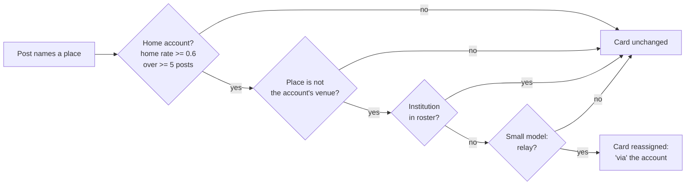

# Case study 1: rule then model, for "who is the host"

**Status: shipped behind a switch, in shadow (it logs what it would change and
changes nothing). November 2026.**

## The problem

A venue often posts about an event that happens somewhere else. Venue A relays
Band X's tour stop at Venue B. The pipeline reads the post from Venue A's
account, so by default the card says the plan is at Venue A, hosted by Venue A.
The place on the card is usually right, because the poster names Venue B. The
host is wrong.

Most accounts post about their own nights. A few relay often. The question is
how to find those cases without breaking the many that are fine.

## The design

Two checks, and the card changes only when both agree.

1. **A cheap rule per account.** The home rate is the share of an account's
   posts with a named place that name the account's own venue. An account with
   a home rate of at least 0.6, over at least 5 such posts, is a "home" account.
   A post from a home account that names a different place is a candidate relay.
   The rule costs nothing and runs on every post.
2. **A small model per candidate.** For each candidate, a small model reads
   the post and answers one question: is this account hosting, or relaying
   someone else's event?
3. **Both must agree.** The card is reassigned ("via Venue A", hosted at Venue B)
   only when the rule flags it and the model confirms it.
4. **A roster mark for institutions.** Some accounts, such as a town hall or a
   cultural centre, run events in many places that are all theirs. They are
   marked in the roster and never reassigned.

## How it was measured

From a 200-card sample, the 99 cards whose place was elsewhere than the
posting account's venue were scored. Two blind labellers (Claude and Codex,
each without the other's answer or any variant's output) said who the host
was. They agreed 81.4% of the time on the full 200-card sample. The 38 cards
they disagreed on were excluded rather than settled by me, so the key is the
cases where two independent labellers agree. Each card is scored right or
wrong on its own.

| Variant | Right | Change | Wrong reassignments | Relay recall |
|---|---|---|---|---|
| Today | 73.7% | — | 0 | 0/26 |
| Rule alone | 68.7% | −5.1 pts | 26 | — |
| Rule + model | 83.8% | +10.1 pts | 8 | 18/26 |
| Rule + model, institutions excluded | 88.9% | +15.2 pts | 3 | 18/26 |

"Relay recall" is how many of the 26 real relays in the key the variant
caught. "Wrong reassignments" are cards that were right and became wrong.

What the table says:

- **The rule alone makes things worse.** It catches relays, but it also moves
  26 cards that were right. On its own it is a candidate list, not a decision.
- **The model is what makes the rule usable.** Adding it cuts wrong
  reassignments from 26 to 8 and keeps 18 of 26 relays.
- **Institutions explain most of what is left.** Excluding them takes wrong
  reassignments from 8 to 3. In that variant 21 cards were reassigned and 3 of
  them (14.3%) were wrong.
- **It is cheap.** The model cost about $0.0124 for 81 calls.

## Caveats

These came from an external review of the eval,
and they limit what the numbers mean.

- **The institution exclusion was chosen after seeing the errors.** That makes
  the last row in-sample. To limit the damage, the institution list was then
  frozen from account names only, without looking at outcomes, and a re-score on
  held-out cards was planned. That re-score has not been run yet, so the +15.2
  points is an upper bound, not a measured gain.
- **One wrong reassignment in seven is not nothing.** A wrong "via" line
  credits the wrong venue in public. That is why the feature runs in shadow first.
- **The key is the agreed cases only.** Excluding 38 disagreements drops the
  hardest cards. The real accuracy on all cards is likely lower for every
  variant, and how much lower was not measured.
- **99 cards is small.** One card is about one percentage point.

## Eval inputs must equal production inputs

The first version of the eval gave the model more than production would. In the
eval, the model saw the post's caption. In production, the caption was not
passed to that step. And when one post is split into several plans, the child
plans did not inherit their parent's caption. So the eval measured a feature
that did not exist.

Both gaps were fixed in production before the feature shipped. The general
rule: build the eval's model input with the same function production uses, not
a copy of it.

## Production safety

- **Cache** keyed by model plus prompt version. The same post is never asked
  twice, and changing the prompt starts a fresh cache instead of mixing answers.
- **A daily cap of 10 calls.** Above that, candidates keep today's behaviour.
- **A 60-second deadline per build, retries included.** When it runs out, the
  build goes on without the model and the cards stay unchanged.

Every limit fails towards "card unchanged", which is today's behaviour.

## Before and after

| | Before | After (rule + model, institutions excluded) |
|---|---|---|
| Venue A relays Band X at Venue B | Hosted by Venue A | Hosted at Venue B, "via Venue A" |
| Venue A's own Friday night | Hosted by Venue A | Unchanged |
| A town hall's event in a park | Hosted by the town hall | Unchanged (roster mark) |
| Model down or over the cap | — | Unchanged |

## What was verified, and what was not

- **Verified:** the counts above, on the 99 scored cards; the model cost for
  the 81 calls; that the eval and production inputs now match.
- **Not verified:** the held-out re-score of the institution exclusion; accuracy
  on the 38 excluded cards; how often relays happen across all accounts, since
  the sample was drawn from cards with a place elsewhere.
