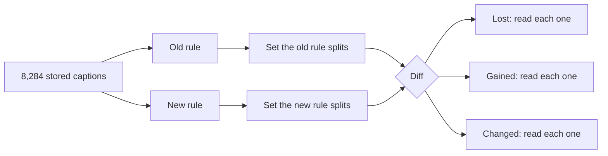

# Case study 2: replaying history in both directions

**Status: switched on in production in November 2026, after the replay below.
It is behind a switch that can turn it off.**

## The problem

Some captions list one act on several dated times. "Jazz trio, Sat 17:00 and
Sun 12:00." The pipeline made one plan for that post, so at least one of the
dates had no plan of its own.

The change is a deterministic rule, not a model call: when a caption lists one
act on two or more dated times, split it into one plan per date. A rule like
this is easy to test against history, because the stored captions can be
replayed through it for free. The interesting part is what the first replay
missed.

## The replay

The rule was run over 8,284 stored captions. Every caption it would split was
checked by hand against the caption: right split, wrong split, or a split that
adds nothing (for example, a second "session" that is only the doors time).

| | Correct splits | Wrong splits | No gain |
|---|---|---|---|
| First version of the rule | 26 | 4 | 1 |
| Final version | 29 | 0 | 1 |

The four wrong splits, made synthetic:

- **A time leaking onto the next day.** "Sat 17:00, Sun 12:00" also produced a
  Sunday 17:00 session that does not exist.
- **A partial split.** A four-night programme came out as two or three plans,
  not four.
- **Two acts cloned.** "Act A on Fri, Act B on Sat" became Act A on both days.
  The rule is for one act on several dates; two acts is a different shape.
- **A ticket sale read as a show.** "Tickets on sale Mon 10:00, show Sat 21:00"
  made a Monday plan.

Of those four, three are now split correctly and one is no longer split at all.

## What the first replay could not see

The first replay listed only the posts the new rule would split. That answers
"are the new rule's splits right?". It cannot answer "did the new rule stop
splitting something it should?".

That mattered. While fixing the wrong cases, the rule became stricter about
what may sit between a day and a time. One real shape is a clock emoji between
them ("Fri ⏰ 22:00"). The stricter rule silently stopped splitting those posts.
A replay that lists only the new rule's splits shows a shorter, cleaner list,
and the shorter list looks like progress. The reviewer caught it, not the
replay.

The fix was to replay both functions, old and new, over the same captions and
diff the two sets of posts each would split:

- **lost:** the old rule splits it, the new one does not;
- **gained:** the new rule splits it, the old one did not;
- **changed:** both split it, into different sessions.

Every post in those three lists gets read. The rest are unchanged by
construction.



On the final version: lost 1, gained 0. The one lost post was one of the four
wrong splits, so losing it is the fix working. Nothing real was lost.

## Before and after

| Caption (synthetic) | Before | After |
|---|---|---|
| "Jazz trio, Sat 17:00 and Sun 12:00" | One plan | Two plans: Sat 17:00, Sun 12:00 |
| "Comedy with Act Y. Fri ⏰ 22:00, Sat ⏰ 22:00" | One plan | Two plans (kept after the both-directions replay) |
| "Act A on Fri 21:00, Act B on Sat 21:00" | One plan | Not split: two acts is not this rule's shape |
| "Tickets on sale Mon 10:00. Show Sat 21:00" | One plan | Unchanged: a ticket sale is not a session |

## Review

Two reviewers read the rule and the replay independently: Claude Opus and
Codex, over three rounds. Each finding became a regression test before it was
fixed, so a later change to the rule that brings a failure back fails the suite.
The clock-emoji case is one of those tests.

## Try it on toy data

The repo has a small, synthetic version of the both-directions replay. It uses
two deliberately naive toy rules, not the production ones:

```bash
npm run replay -- examples/replay/captions.json
```

On the 8 invented captions in `examples/replay/captions.json`, both toy rules
split 5. A replay of the new rule alone would show those 5 and nothing else. The
diff shows that the new rule lost one (the clock-emoji caption) and gained one
(a "21h" time the old rule could not read). Both toy rules also wrongly split
the ticket-sale and two-acts captions, which is the kind of error only a person
reading the splits finds. Code: `src/replay.ts`; tests:
`src/__tests__/replay.test.ts`.

## Caveats

- **31 split candidates is small.** The rule touches very few posts. A wrong
  shape that appears once a month may not be in 8,284 captions.
- **The split labels were not double-blind.** Each split was judged right or
  wrong by reading it against its caption, not by two blind labellers as in
  case study 1.
- **Captions only.** The rule reads the caption. A poster image that lists
  dates the caption does not is out of scope, and how often that happens was not
  measured.
- **"No gain" is a judgment.** It means the split is not wrong but adds a plan
  nobody needs.

## What was verified, and what was not

- **Verified:** the counts on the 8,284 stored captions for both versions; the
  lost/gained diff (lost 1, gained 0); that each review finding has a
  regression test.
- **Not verified:** the rule's effect on new posts after it switches on; the
  error rate on shapes absent from the stored captions.

## The lesson

When a rule gets stricter, the cases it stops handling vanish from any report
built from its own output. Replay the old and the new function on the same
inputs, and read the difference in both directions.
