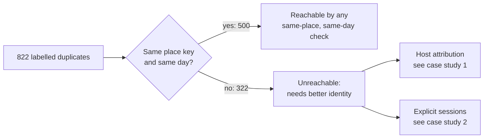

# Case study 3: a trade-off and a negative result in duplicate detection

**Status: the stricter rule shipped with its switch off by default. The list
judge was dropped. November 2026.**

## The problem

The same plan reaches the pipeline more than once. Venue A posts its Friday
gig on Monday and again on Thursday. Band X posts the same gig from its own
account. A listings site has it too. Each copy should become one card, not
three.

Two errors pull in opposite directions:

- a **wrong merge** joins two different plans, and one of them disappears from
  the agenda;
- a **missed duplicate** leaves two cards for one plan, which looks sloppy.

A wrong merge is worse: a missed duplicate is visible and harmless, a wrong
merge hides a real plan and nobody notices. So the target was fewer wrong
merges, at an acceptable cost in missed duplicates.

## The data

3,868 labelled pairs of cards, each labelled "same plan" or "different plans":

| Source | Same | Different |
|---|---|---|
| Database (cards the pipeline made) | 718 | 2,791 |
| Other sources | 104 | 255 |

So 822 labelled duplicates in all.

## A stricter rule: a trade-off, not a win

| Rule | Wrong merges | Missed duplicates | Right overall |
|---|---|---|---|
| Old rule | 18 | 142 | about 96% |
| Stricter rule | 2 (−89%) | 160 (+13%) | about 96% |

Accuracy overall is the same either way, so it cannot decide this. What changes
is which error you get. The stricter rule removes almost all wrong merges and
pays for it with 18 more missed duplicates. That is a product choice, not a
measurement, so the rule shipped with its switch off by default.

On the held-out half of the database pairs, wrong merges went from 17 to 2 and
missed duplicates from 70 to 43. The drop in wrong merges replicates. The missed
duplicates moved the other way from the full set (down, not up). That
difference was not investigated, so the miss side should be read as uncertain.

## Small-model judges on top: a negative result

The stricter rule leaves 129 missed duplicates in the database pairs. Two ways
of adding a small model were tried.

- **Pairwise judge.** The model sees two cards the rule did not merge and
  answers "same plan or not".
- **Venue-day list judge.** The model sees every card for one venue on one day
  as a list, and groups the ones that are the same plan. The idea was that seeing
  the whole day at once gives more context, at fewer calls.

Database pairs, all of them:

| Rule | Wrong merges | Missed duplicates |
|---|---|---|
| Stricter rule | 2 | 129 |
| + pairwise judge | 2 | 90 |
| + venue-day list judge | 2 | 108 |
| List judge alone | 0 | 365 |

The list judge cost $0.058 for 294 calls.

The list idea lost. On top of the rule, it recovers 21 duplicates where the
pairwise judge recovers 39, with the same wrong merges. On its own it never
merges wrongly, but it misses more than half the duplicates. It was dropped. A
negative result is still a result: it stops the same idea being tried again
next month.

## The structural finding

322 of the 822 labelled duplicates sit under a different place key or a
different day key. Venue A relays Band X's gig at Venue B: one card is filed
under Venue A, the other under Venue B. A two-day festival posted once per day
and once as a whole: the days do not line up.

No check that compares cards from the same place on the same day can ever see
those pairs, however smart it is. That caps every matcher above, the judges
included. The fix is better identity upstream: get the host right (case study
1) and turn dated sessions into explicit plans (case study 2), so that copies of
one plan land under the same key in the first place.

## What the external review advised against

The method was reviewed externally. Two recommendations:

- **Do not adopt a full record-linkage stack** (a Fellegi–Sunter model, for
  example through Splink) at about 100 new records a day. The setup and tuning
  cost does not pay back at this volume, and the structural gap above is not a
  matching problem.
- **Avoid unrestricted transitive clustering.** If A matches B and B matches C,
  merging all three lets one wrong link chain unrelated plans together. Merges
  stay pairwise, or bounded.

## Before and after

| | Before | After (stricter rule) |
|---|---|---|
| Venue A posts the same gig on Monday and Thursday | One card | One card |
| Two different gigs at Venue A on the same night, similar titles | Sometimes one card (wrong merge) | Two cards |
| Venue A relays Band X at Venue B | Two cards | Two cards (different place keys: out of reach) |
| Wrong merges on all labelled pairs | 18 | 2 |
| Missed duplicates on all labelled pairs | 142 | 160 |

## Caveats

- **Database pairs come from cards the pipeline made.** They show the
  pipeline's own kind of duplicates; pairs it never produced are not in them.
- **No run-to-run range is reported for the judges.** A difference of a few
  pairs between judges may be noise. Treat 90 against 108 as a real gap and
  smaller ones as unproven.
- **"Right overall" hides the trade-off.** About 96% for both rules is true and
  useless for the decision.
- **The held-out miss count disagrees in direction** with the full-set count, as
  noted above.

## What was verified, and what was not

- **Verified:** the counts in each table, on the labelled pairs; the list
  judge's cost; the 322 of 822 duplicates under a different place or day key.
- **Not verified:** how the stricter rule behaves on new posts after it is
  switched on; whether better identity actually recovers the 322, which is the
  claim the next work has to test.
