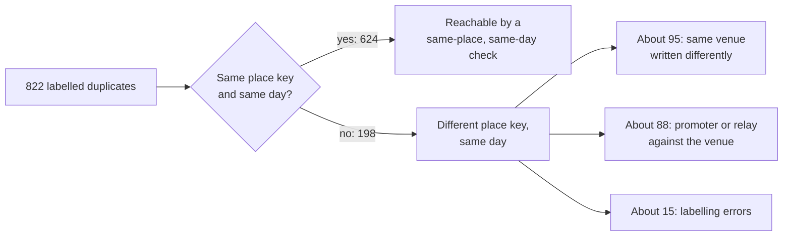

# Case study 3: a trade-off in duplicate detection, and a bench bug

**Status: the stricter rule shipped with its switch off by default. November
2026.**

## The problem

The same plan reaches the pipeline more than once. Venue A posts its Friday
gig on Monday and again on Thursday. Band X posts the same gig from its own
account. A listings site has it too. Each copy should become one card, not
three.

Two errors pull in opposite directions:

- a **wrong merge** joins two different plans, and one of them disappears from
  the agenda;
- a **missed duplicate** leaves two cards for one plan, which looks sloppy.

A wrong merge is worse: a missed duplicate is visible and harmless, a wrong
merge hides a real plan and nobody notices. So the target was fewer wrong
merges, at an acceptable cost in missed duplicates.

## The data

3,868 labelled pairs of cards, each labelled "same plan" or "different plans":

| Source | Same | Different |
|---|---|---|
| Database (cards the pipeline made) | 718 | 2,791 |
| Other sources | 104 | 255 |

So 822 labelled duplicates in all.

How the pairs were chosen and labelled. A candidate pair is two cards in the
same city on the same day, or from the same account within three days.
Candidates were sampled in layers: pairs some rule already merges, pairs that
share an identifying word, place or account, and a random sample of the rest.
For the first measurement (1,865 pairs), one model labelled every pair blind,
from the listing text only and without seeing any rule's answer. A second
model labelled again every pair where the first contradicted a rule, plus 100
random agreements. The owner settled the 19 pairs where the two disagreed. The
later pairs that bring the total to 3,868 are not documented here in the same
detail.

## A stricter rule: a trade-off, not a win

| Rule | Wrong merges | Missed duplicates | Right overall |
|---|---|---|---|
| Old rule | 18 | 142 | about 96% |
| Stricter rule | 2 (−89%) | 160 (+13%) | about 96% |

Accuracy overall is the same either way, so it cannot decide this. What changes
is which error you get. The stricter rule removes almost all wrong merges and
pays for it with 18 more missed duplicates. That is a product choice, not a
measurement, so the rule shipped with its switch off by default.

The database pairs were split into two halves by a hash of the posting
account, so one account's cards never sit in both halves. The rule was shaped
on one half, but it was adjusted while full-set results were visible, so the
other half is a weaker check than a clean freeze. On that half, wrong merges
went from 17 to 2 and missed duplicates from 70 to 43. The missed duplicates
moved the other way from the full set (down, not up). That difference was not
investigated, so the miss side should be read as uncertain. A re-run on later
cards, with fresh labels, is planned.

## Small-model judges on top: a result I nearly got wrong

The stricter rule leaves 129 missed duplicates in the database pairs. Two ways
of adding a small model were tried.

- **Pairwise judge.** The model sees two cards the rule did not merge and
  answers "same plan or not".
- **Venue-day list judge.** The model sees every card for one venue on one day
  as a list, and groups the ones that are the same plan. The idea was that seeing
  the whole day at once gives more context, at fewer calls.

The first run said the list idea lost. It did not. My bench capped each list at
8 cards, so bigger venue-days were cut into pieces, and duplicates that fell in
different pieces could never be grouped. With the cap raised to 25, which no
group exceeds, the numbers are these.

Database pairs (718 duplicates):

| Rule | Wrong merges | Missed duplicates |
|---|---|---|
| Stricter rule | 2 | 129 |
| + pairwise judge | 2 | 90 |
| + venue-day list judge | 2 | 94 |
| List judge alone | 0 | 309 |

Other sources (104 duplicates):

| Rule | Wrong merges | Missed duplicates |
|---|---|---|
| Stricter rule | 0 | 31 |
| + pairwise judge | 0 | 25 |
| + venue-day list judge | 0 | 28 |
| List judge alone | 0 | 50 |

On the held-out half of the database pairs, the list judge on top of the rule
had 2 wrong merges and 40 missed; the pairwise judge had 2 and 42. The
corrected run cost about $0.064 in total. Each judge was run once, with no
repeats.

The honest verdict: the list judge is about as good as the pairwise judge, not
clearly worse. It made no wrong merges of its own; the 2 in its rows come from
the rule. The gap in the first run came mostly from my own bench's cap. The
lesson is one sentence: before concluding an idea lost, check the harness that
measured it.

## The structural finding

198 of the 822 pairs labelled as duplicates (24%) are out of reach of any check that
compares cards from the same place on the same day. All 198 have a different
place key on the same day; none differ by day. An earlier version of this page
said 322. That count included 124 pairs that shared a place and a day and were
split only by the same 8-card cap.

A seeded sample of 40 of the 198, scaled up, splits them roughly like this:

- **About 95: the same venue written two ways.** Venue A on one card, "Sala
  Venue A" on the other. The fix is place-name normalisation.
- **About 88: a promoter or relay against the venue.** Venue A relays Band X's
  gig at Venue B: one card is filed under Venue A, the other under Venue B. The
  fix is a canonical host identity (case study 1). A fixed alias table is
  unsafe, because one promoter uses several venues.
- **About 15: labelling errors.** The pair is not really a duplicate.

These shares come from one seeded sample of 40 pairs, concentrated in a few
events, so treat them as rough proportions, not precise counts. The sample also
suggests some of the 198 are labelling errors rather than real duplicates. Per-session cards (case study 2)
recover none of the 198, since none of them differ by day.

No same-place, same-day check can see these pairs, however smart it is. That
caps every matcher above, the judges included. The fix is better identity
upstream, so that copies of one plan land under the same key in the first
place.

## What the external review advised against

The method was reviewed externally. Two recommendations:

- **Do not adopt a full record-linkage stack** (a Fellegi–Sunter model, for
  example through Splink) at about 100 new records a day. The setup and tuning
  cost does not pay back at this volume, and the structural gap above is not a
  matching problem.
- **Avoid unrestricted transitive clustering.** If A matches B and B matches C,
  merging all three lets one wrong link chain unrelated plans together. Merges
  stay pairwise, or bounded.

## Before and after

| | Old rule | Stricter rule | Stricter rule + pairwise model judge |
|---|---|---|---|
| Venue A posts the same gig on Monday and Thursday | One card | One card | One card |
| Two different gigs at Venue A on the same night, similar titles | Sometimes one card (wrong merge) | Two cards | Two cards |
| Venue A relays Band X at Venue B | Two cards | Two cards (different place keys: out of reach) | Two cards (out of reach) |
| Wrong merges, database pairs (718 duplicates) | 18 | 2 | 2 |
| Missed duplicates, database pairs | 126 | 129 | 90 |
| Wrong merges, other sources (104 duplicates) | 0 | 0 | 0 |
| Missed duplicates, other sources | 16 | 31 | 25 |

The stricter rule alone is a trade: fewer wrong merges, more misses. The
stricter rule plus the pairwise judge is better on both counts for the
database pairs: wrong merges 18 → 2, missed duplicates 126 → 90. On the
smaller other-sources set it still misses more than the old rule (25 against
16). That is a known weakness.

The relay row stays out of reach for every column. It is one of the 198
duplicates under a different place key, described above.

## Caveats

- **Database pairs come from cards the pipeline made.** They show the
  pipeline's own kind of duplicates; pairs it never produced are not in them.
- **No run-to-run range is reported for the judges.** Each judge was run once.
  A difference of a few pairs between judges may be noise. 90 against 94 is
  within that, so the two judges are level on this data.
- **The out-of-reach split is a 40-pair sample.** The shares are rough:
  one seeded sample, concentrated in a few events.
- **"Right overall" hides the trade-off.** About 96% for both rules is true and
  useless for the decision.
- **The held-out half is not a clean freeze.** The rule was adjusted while
  full-set results were visible, and its miss count disagrees in direction with
  the full-set count, as noted above.

## What was verified, and what was not

- **Verified:** the counts in each table, on the labelled pairs; the corrected
  list-judge run with the 25-card cap and its cost; the 198 of 822 duplicates
  under a different place key on the same day.
- **Not verified:** how the stricter rule behaves on new posts after it is
  switched on; the exact split of the 198, which comes from a 40-pair sample;
  whether place-name normalisation and a canonical host recover them, which is
  the claim the next work has to test.
